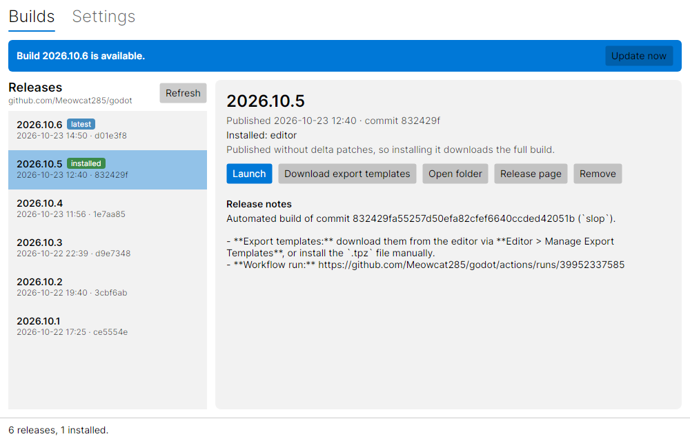

# Meow Godot Launcher

A cross-platform (Windows, macOS, Linux) build manager for [Meowcat285/godot](https://github.com/Meowcat285/godot),
written in C# with [Avalonia UI](https://avaloniaui.net/).

It lists the fork's releases, installs editor builds and export templates side by side, launches them, and keeps
them up to date with **delta patches**, so updating a build downloads only what changed instead of the full archive.



## Features

- Browse releases of the fork, with their notes and commit, or the pre-releases built from any of its branches.
- Install any number of builds side by side, launch them, open their folder, remove them.
- Delta updates from any installed build, chaining several releases when needed, with automatic fallback to the
  full download if anything doesn't check out.
- Export templates per build, picked per platform like in the editor's export template manager: only the
  templates of the chosen platforms are downloaded, and platforms can be added or removed later. The templates
  are copied into Godot's export templates folder when launching that build.
- Works offline with the releases it has already seen.

## Download

Grab the download for your platform from the [latest release](https://github.com/Meowcat285/meow-godot-launcher/releases/latest).
Each one is a natively compiled (Native AOT) executable with the few native libraries it uses, no .NET installation
needed.

| Platform | Download |
| --- | --- |
| Windows (x64, also runs on Arm64) | `MeowGodotLauncher-win-x64-Setup.exe` (installer), or `MeowGodotLauncher-win-x64-Portable.zip` |
| macOS (Apple Silicon) | `MeowGodotLauncher-osx-arm64-Portable.zip` |
| macOS (Intel) | `MeowGodotLauncher-osx-x64-Portable.zip` |
| Linux (x64) | `MeowGodotLauncher-linux-x64.AppImage` |

The Windows installer needs no administrator rights and adds the launcher to the Start menu. On macOS, unzip the app
and move it to Applications. It's signed and notarized, so it opens like any other downloaded app. On Linux, make the
AppImage executable and run it.

The launcher keeps itself up to date: when a new version is out, it offers to update and restart, downloading only
what changed.

## Usage

Open the launcher and pick a release from the list to install it. Installed builds can be launched, updated to a
newer release, or removed from the same window. Each build's **Export templates** tab chooses which platforms'
templates to install; the default for new builds (the platform the launcher runs on) can be changed in Settings.

Builds are stored in `%LOCALAPPDATA%\MeowGodotLauncher` on Windows, `~/Library/Application Support/MeowGodotLauncher`
on macOS, and `~/.local/share/meow-godot-launcher` on Linux. The library folder can be changed in Settings.

The launcher talks to the GitHub API anonymously, which allows 60 requests per hour, and caches responses so
refreshing rarely counts against that limit. If you still run into it, add a GitHub token (no scopes needed) in
Settings.

## How updates work

Each release of the fork comes with delta patches against the previous releases, published as extra release
assets alongside a manifest listing every package's files and checksums. When updating, the launcher picks the
cheapest way to get to the new release: a single delta, a chain of deltas through intermediate releases, or the
full archive when that's smaller or no delta is available (for example for releases older than the delta
patches).

Patching happens in a staging folder. The result is verified file by file against SHA-256 checksums and only then
moved into place, so a failed or cancelled update never breaks an installed build.

An editor update typically downloads under a tenth of the full archive. Export templates are fetched per platform
with HTTP range requests, so an update only downloads the patches for the platforms you have installed.

## Building from source

Requires the [.NET 10 SDK](https://dotnet.microsoft.com/download).

```sh
dotnet build MeowGodotLauncher.slnx
dotnet test MeowGodotLauncher.slnx
dotnet run --project src/MeowGodotLauncher
```

To produce a Native AOT build like the released ones (this needs the platform's native toolchain: Visual Studio's C++
tools on Windows, Xcode on macOS, clang on Linux; see
[the prerequisites](https://learn.microsoft.com/dotnet/core/deploying/native-aot/#prerequisites)):

```sh
dotnet publish src/MeowGodotLauncher -c Release -r linux-x64 -o publish   # or win-x64, osx-arm64, osx-x64
```

### Layout

- `src/MeowGodotLauncher.Core`: everything that isn't UI. GitHub client, library of installed builds, installer,
  update planner and delta patch applier.
- `src/MeowGodotLauncher`: the Avalonia app (MVVM, with CommunityToolkit.Mvvm).
- `tests/MeowGodotLauncher.Core.Tests`: unit tests. `Fixtures/` holds a small delta made by the real generator,
  so the C# applier is tested against its output; `Fixtures/make_fixtures.py` regenerates it.

### Delta format

Deltas are generated in the fork by
[`misc/scripts/generate_delta_patches.py`](https://github.com/Meowcat285/godot/blob/slop/misc/scripts/generate_delta_patches.py)
and applied here by `src/MeowGodotLauncher.Core/Delta`. A delta holds one operation per file of the new package:
copy an unchanged (or renamed) file from the installed build, patch a changed file (HDiffPatch, compressed with zstd; bsdiff in older releases),
or add a new one. Zip archives inside a package are patched entry by entry and rebuilt by the launcher.

The format is defined on both sides, so keep them in sync and bump the `format` number on incompatible changes.

## License

[MIT](LICENSE). Third-party components: Avalonia, CommunityToolkit.Mvvm and ZstdSharp (MIT), and the Inter font
(SIL Open Font License 1.1).
